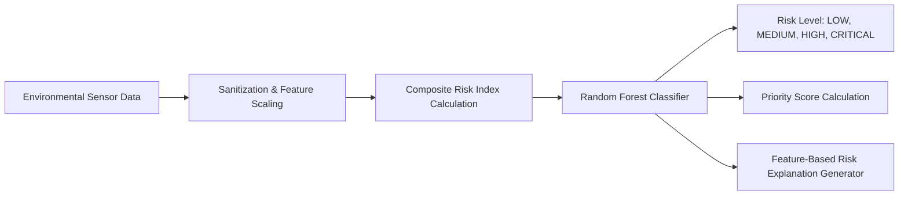

# Machine Learning Pipeline & AI Risk Engine Documentation

## 1. Executive Summary
The **AI Risk Engine** evaluates incoming multi-hazard disaster reports (Floods, Cyclones, Earthquakes, Landslides, Wildfires) by sanitizing environmental sensor metrics, scaling numerical parameters, running inference through a pre-trained **Random Forest Classifier** (`ml/model.pkl`), computing an operational priority score, and extracting human-readable feature attribution explanations.

---

## 2. Risk Calculation Pipeline

---

## 3. Input Features & Formulations

| Feature | Variable | Range | Unit / Scale | Description |
| :--- | :--- | :--- | :--- | :--- |
| **Rainfall** | `rainfall` | 0 – 500 | mm | Recorded precipitation volume |
| **Wind Speed** | `wind_speed` | 0 – 250 | km/h | Recorded wind velocity |
| **Water Level** | `water_level` | 0 – 10 | m | Water level above river danger mark |
| **Humidity** | `humidity` | 0 – 100 | % | Relative atmospheric humidity |
| **Historical Vulnerability** | `historical_indicator` | 0.0 – 1.0 | Score | Historical disaster frequency index |
| **Severity** | `severity` | 1 – 5 | Level | Ground reporter disaster severity rating |
| **Affected Population** | `affected_population` | 0 – 50,000 | Count | Number of citizens in immediate hazard zone |

---

## 4. Operational Priority Score Formula

$$\text{Priority Score} = 0.50 \cdot \text{Risk Score} + 0.30 \cdot \left(\frac{\text{Severity}}{5} \cdot 100\right) + 0.20 \cdot \min\left(100, \frac{\ln(1 + \text{Affected Population})}{\ln(1 + 10000)} \cdot 100\right)$$

- **Score Range**: 0.0 to 100.0 (Sorted in descending order for Admin Command Center prioritization).

---

## 5. Explainable AI Risk Attribution Examples
- *Rainfall > 150 mm*: `"Torrential rainfall recorded ({rainfall} mm), significantly heightening flood/inundation hazard."`
- *Water Level > 3.0 m*: `"Critical water level measurement ({water_level} m) approaching or exceeding danger marks."`
- *Wind Speed > 90 km/h*: `"Gale/storm-force wind speeds detected ({wind_speed} km/h) posing structural risk."`
- *Historical Index > 0.6*: `"High historical vulnerability index ({historical}) indicates recurrent disaster zone."`
